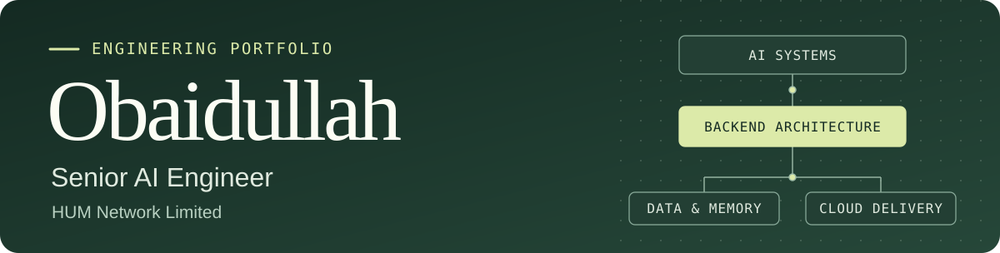

# 

**Senior AI Engineer at HUM Network Limited**  
I build AI systems, real-time backends, and the software that connects them to users.

**[Explore my portfolio ↗](https://obaidois.github.io/ObaidOIS/)** · [LinkedIn](https://www.linkedin.com/in/obaidullah-ishtiaq/) · [Upwork](https://www.upwork.com/freelancers/~01a6339fab51740027) · [Email](mailto:obaidch00@gmail.com)

## Current focus

At **HUM AI Lab**, I work on internal workflow automation and oversee systems developed by external partners. Previously, I led delivery of AI agent infrastructure, LLM security, and multi-tenant SaaS at **Cplusoft**.

## Selected engineering work

| Project | What I led or built |
| :--- | :--- |
| **[Neurow](https://www.neurow.io/)** | Led the memory and MCP tool layer for an AI coaching product. Built consent and intent checks for agent access and revision history for goals and plans. |
| **[SAHMK](https://www.sahmk.sa/en)** | Built real-time market data and alerts for web, mobile, and WhatsApp. Integrated OpenAI analysis and led production deployment. |
| **[TravelMaster](https://travelmaster.ie/about-us/)** | Led delivery across backend services, passenger and driver apps, and an operator dashboard for event transport. |
| **Capital Rock** | Built nine Solidity contracts for real-world asset tokenization, including an on-chain order book with atomic settlement. The test suite recorded 499 passing tests, and the contracts were deployed to Polygon testnet. |

## Technical toolkit

| Area | Tools |
| :--- | :--- |
| AI and agents | Python · OpenAI · MCP · FastMCP · Qdrant · Neo4j |
| Backend and data | FastAPI · Django REST Framework · PostgreSQL · Redis · Celery · Socket.IO |
| Web and mobile | Next.js · React · TypeScript · React Native |
| Cloud and delivery | Google Cloud · AWS · Docker · Nginx · GitHub Actions |
| Blockchain | Solidity · Hardhat · OpenZeppelin · Polygon · Ethereum Name Service |
